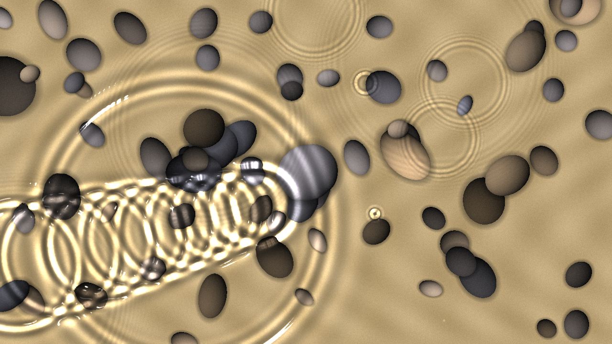
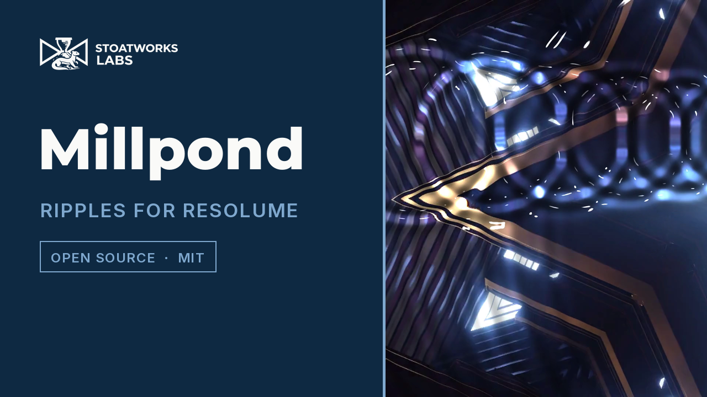
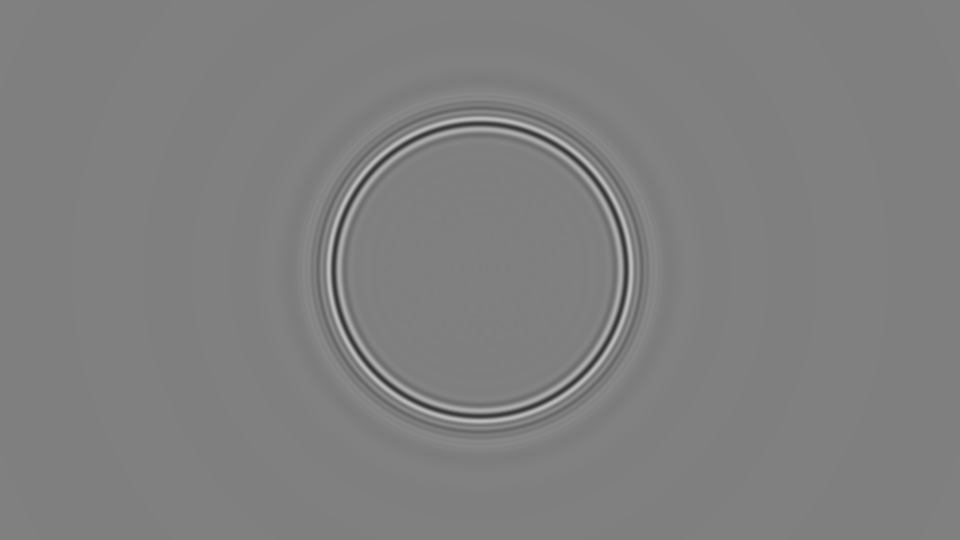

# millpond

> **AI-assisted project.** This codebase was created with [Claude](https://claude.com/claude-code)
> (Anthropic), directed and reviewed by a human author. It has run in
> Resolume only briefly: Arena 7.27.1 on Windows, on a software rasteriser, and
> Arena 7.29.0 on a Mac, where the Faraday waves new in v0.2.0 pulsed to a
> music file in the composition. It has never been in a show. Everything below
> is measured by an offline harness
> that drives the plugin's own class in a headless GL context: the water against
> the exact Cauchy–Poisson integral, evaluated in double precision (they agree to
> **0.01%**), and the light against Snell and Fresnel, with every check also run
> against a wrong model to show it can fail. The full rundown is under
> [Status](#status).

> **Photosensitivity warning.** Faraday waves (Shake, off by default) can flash.
> At the default Slow Motion 8× the lattice reverses about 1.25 times a second,
> but at Slow Motion 1× or 2× and full Shake, over Resolume's demo clips and
> bass, the picture flashed up to **10 times a second** (20 at a 20 Hz Drive),
> far over the three-a-second line in Ofcom's and WCAG's guidance. The lattice
> is also a strong regular pattern over the whole frame, which ITU-R BT.1702 and
> Ofcom treat as a hazard of its own. See [Faraday waves](#faraday-waves) and
> the guide's [flashing section](https://stoatworks-labs.com/software/millpond/guide/#flashing-and-keeping-it-safe).

Ripples for Resolume Arena and Avenue, as an FFGL effect. Drop a pebble, skim a
stone or let it rain. The clip becomes the bed of a pond, and you look down at it
through the water. It's the only water feature a venue will happily let you put
on stage.

The [project page](https://stoatworks-labs.com/software/millpond/) has the downloads and the video, and
the [user guide](https://stoatworks-labs.com/software/millpond/guide/) explains every control.

A skim across the lower left (its hops shorten towards the sink on the
right), the rings of a pebble dropped a second and a half earlier, and a light
rain. The picture under the water is the harness's own card. Rendered by the
plugin's offline harness (`mptest`) rather than captured from Resolume.

*[Watch it](https://www.youtube.com/watch?v=oAbXjVXFwYA) (52 seconds): one pebble and the still
water it leaves, two pebbles whose rings cross, two skimmed stones, a walled pond throwing its
waves back, and rain with the sunlight bent through it. It's all the plugin's own output,
rendered by its offline harness from Resolume's own demo clips rather than captured from
Resolume.*

<!-- downloads:start -->

## Download

**[v0.2.0](https://github.com/stoatworks-labs/millpond/releases/tag/v0.2.0)** — prebuilt for macOS and Windows. Pick your platform:

<b>macOS</b> — Universal (Apple Silicon + Intel)

| Build | Download | Size |
| --- | --- | --- |
| Universal (Apple Silicon + Intel) · .dmg disk image | [`millpond-0.2.0-macos-universal.dmg`](https://github.com/stoatworks-labs/millpond/releases/download/v0.2.0/millpond-0.2.0-macos-universal.dmg) | 282 KB |
| Universal (Apple Silicon + Intel) · .zip archive | [`millpond-macos-universal.zip`](https://github.com/stoatworks-labs/millpond/releases/latest/download/millpond-macos-universal.zip) | 232 KB |

<b>Windows</b> — x64

| Build | Download | Size |
| --- | --- | --- |
| x64 · .exe installer | [`millpond-0.2.0-windows-x86_64-setup.exe`](https://github.com/stoatworks-labs/millpond/releases/download/v0.2.0/millpond-0.2.0-windows-x86_64-setup.exe) | 267 KB |
| x64 · .zip archive | [`millpond-windows-x86_64.zip`](https://github.com/stoatworks-labs/millpond/releases/latest/download/millpond-windows-x86_64.zip) | 136 KB |

All builds, checksums and release notes: [github.com/stoatworks-labs/millpond/releases](https://github.com/stoatworks-labs/millpond/releases).

macOS builds are signed and notarised and open normally. The Windows builds are unsigned, so SmartScreen warns once.

<!-- downloads:end -->

## The one idea

**The water obeys the linear water-wave equations, exactly, and the light
obeys Snell and Fresnel.** Nothing is drawn on. A pebble is a crater pushed into
the surface. From then on every wavelength travels at the speed the dispersion
relation gives it,

    ω² = ( g k + (σ/ρ) k³ ) tanh( k h )

(gravity, surface tension and depth), and dies away at the rate viscosity
gives it. Every frame the surface goes through a Fourier transform on the GPU
and each wave is advanced by exactly the right phase for the time that has
passed. There's no time step to go unstable and no numerical dispersion: the
dispersion is the formula.

What falls out of that, without anyone arranging it:

- **The still disc inside the ring.** Surface tension gives water a slowest
  speed at which a ripple can carry energy: 17.8 cm/s, at a wavelength of
  4.4 cm. Nothing can be inside a disc growing at that speed. So a dropped stone
  leaves a ring with calm water in the middle, and the ring's inner edge has
  the soft, banded shape of an Airy function.
- **Long waves out front, short ones behind.** Without surface tension, a
  crater gives the classic Cauchy–Poisson pattern: at radius r and time t the
  wavelength is 8πr²/(g t²), longest at the leading edge.
- **Shallow water holds its long waves back** to √(g h), so the same stone in
  a centimetre of water throws a different ring.
- **The picture wobbles by exactly as much as it should.** The view ray bends
  at the surface (n = 1.333) and lands on the bed a depth below.
- **The caustic net on the bed.** Sunlight refracted through the same surface
  bunches into bright lines where the water focuses it. It's splatted as a
  mesh whose triangles each carry their own light, so the total is conserved
  however violent the net gets. The sun's size blurs it by depth × tan(radius),
  so deep water and a hazy sky wash it out.
- **The glints.** The exact Fresnel reflection of the sky is 2% looking
  straight down and rises towards the edges of a slope. Where a facet points
  the sun at the camera, you get the sun.

**The same Depth drives both halves.** A shallow pond both bends the picture
less and slows its long waves. It's one depth, so it's one control.

View → Height, three seconds after a 1.5 cm pebble on 2 m of clean
water. The disc inside the ring is still, because no ripple on water can carry
energy slower than 17.8 cm/s. The ring's edge sits within a centimetre of
where the Airy function says it must. Rendered by `mptest`.

### A skimmed stone

Each bounce of a skimmed stone costs about the same energy
([Bocquet, 2003](https://doi.org/10.1119/1.1519232)). So after n bounces
V² = V₀²(1 − n/N), and each hop is a projectile. **The hops get shorter
linearly and quicker as a square root**, which is what a real skim looks like.
After N touches it has nothing left and sinks with a full-sized plop. The
touches go into the water as craters at the right places and times, and the
water does the rest: a line of rings, oldest and widest where the throw
started.

## Controls

- **Pond:** Pond Size (the frame's height in metres, 0.1 to 20) and Depth
  (2 mm to 2 m). Surface Tension: 0 is pure gravity waves, and the middle of
  the travel is clean water. Viscosity runs from water to golden syrup, which
  really is overdamped at short wavelengths, and the propagator knows it.
  Speed: 0 freezes the water. Banks: *Open* is a lake, where what leaves the
  frame never comes back. *Walls* is a pool, where the edges reflect exactly
  to every order. Detail is the grid (256 to 2048 along the domain's long
  side). Still flattens the water.
- **Pebble:** Drop, Pebble X/Y, Pebble Size, Splash and Scatter. The crater's
  spectrum peaks at k = 2/a, so the size decides which part of the dispersion
  curve it rings: a small pebble makes capillary ripples, a big one throws
  gravity rings.
- **Skim:** Skim, Heading, Throw Speed, Skim Angle and Bounces. The stone
  comes in from the bank on the far side of Pebble X/Y and passes through
  that point.
- **Rain:** Rain (drops per second, a Poisson process in water-time, so a
  frozen pond has no rain on it) and Rain Size. Raindrops have their own
  crater depth; Splash is the pebble's.
- **Audio:** Audio (Resolume's FFT buffer). Audio Pebbles is the onset
  detector's sensitivity and on/off switch: each hit drops a pebble, its
  splash following how hard the hit was. Audio Rain thickens the rain with the
  level.
- **Light:** Caustics (1 is physical), Sun Elevation, Sun Azimuth and Sun Size
  (angular radius: 0.27° is the real sun, several degrees is haze). Reflection
  (1 is the exact Fresnel term), Sky and Glint.
- **Output:** View shows *Picture*, the effect. It can also show one model on
  its own: *Height*, *Slope* or *Caustics*, which also work as a source of
  pure water patterns. Mix.
- **Faraday:** the tank shaken up and down by the bass (below). Shake (0 is
  off, and the pond is exactly as it was; 1 drives the loudest bass to four
  times the threshold), Drive (5 to 120 Hz, default 10), Damping (the walls'
  loss, 0 to 30 per second, default 2), Slow Motion (a stroboscope, 1 to
  100×, default 8), Pattern (Stripes, Squares or Hexagons) and Bass Bins
  (how many of the host's lowest FFT bins count as bass, default 2). They
  sit after the About block, as ids 40–45, so v0.1.0 compositions load
  unchanged.
- **About:** the name, version and licence, and buttons that open the user
  guide (new in v0.2.0), the project page, the source and the support page.
  v0.1.0's three buttons each moved down one id to make room; they are
  buttons and hold no state, and ids 0–35 are exactly v0.1.0's.

A camera looking straight down only sees the sun in a facet tilted by half the
sun's zenith angle. Ripples rarely tilt more than a few degrees, so glints
need a high sun, and the default is 85°.

### Faraday waves

Shake a tray of water up and down and, past a threshold, the surface stands up
in a lattice that rises and falls at exactly half the shaking frequency
(Faraday saw it in 1831). Here the bass does the shaking. In the tank's frame
gravity becomes g − a cos Ωt, and every wave millpond already rings becomes a
damped Mathieu oscillator. Above the first instability tongue the waves at
half the drive grow. Nothing about the lattice is drawn: its spacing is the
same dispersion relation solved at Ω/2, its onset is the tongue, and the bed
is seen through it by the same optics. A nonlinear damping on the waves'
envelope holds the lattice at a finite height, and a kernel in that damping
decides whether stripes, squares or hexagons win. At full Shake the pond
stands up in about two seconds; when the bass drops, the lattice lies down
at the Damping's rate (2 per second by default).

The lattice oscillates at 5 Hz at the default 10 Hz drive. Unslowed, that's a
high-contrast pattern reversing ten times a second, so **Slow Motion is a
stroboscope and is on at 8× by default**. The water keeps real time, so the
lattice still stands up and lies down with the music, but the oscillation is
seen 8 times slower. Anything that isn't the lattice (rain, pebbles) is seen
in jumps. Slow Motion 1 turns it off.

**It can flash, and the lattice is a strong regular pattern.** Measured with
xenon's rule (whole frame and third-of-frame windows, linear light, 640×360 at
60 fps, 20 s each) over ten pairings: seven of Resolume's demo clips under its
demo bass and beat stems, a generated drone and a generated kick.

| | over 3 flashes/s | worst second |
| --- | --- | --- |
| Shake 0 (the default), or Shake ½ at any Slow Motion | 0 of 10 | 2.5 flashes, the clip's own |
| full Shake, Slow Motion 8× | 1 of 10 | 3.5, on a clip that flickers 2.5 bare |
| full Shake, Slow Motion 2× | 7 of 10 | 5.5 |
| full Shake, Slow Motion 1× | 8 of 10 | 10.5, the whole frame too |
| full Shake, Slow Motion 1×, Drive 20 Hz | 6 of 10 | 20.5 |

So the warning is in this README, the guide, the release notes and the demo,
and the defaults stay as built: Shake 0, and Slow Motion 8× when it's on. At
full Shake the lattice is twenty or more light and dark cells up the frame,
over all of it, oscillating: the kind of regular pattern ITU-R BT.1702 and
Ofcom's guidance treat as a hazard whatever the flash rate. Keep Shake low or
Mix down if anyone watching may be photosensitive.

## Status

**v0.2.0, 2026-11-19, and still early days.** v0.2.0 adds Faraday waves
and the user guide. With Shake at 0, the default, it is v0.1.0 bit for bit.

**In Arena 7.29.0 on a Mac** (Apple Silicon, v0.2.0, 2026-11-19), in a scratch
composition driven over Arena's REST API and read from its output snapshots:

- it registered as `SW Millpond` with all 47 controls (Arena's Opacity and
  Audio picker included), each with its declared name, order, type and
  default. The About line reads `Millpond v0.2.0 - MIT - Stoatworks Labs,
  stoatworks-labs.com`;
- Mix 0 was the clip exactly. With Rain at 0 the water settled to the clip
  plus the sky's reflection, a Drop press rang it, and rain kept it moving;
- **Resolume's FFT reached it.** With Shake at full, Slow Motion 1× and View
  Height, and Resolume's demo `Bass 001.wav` or `Beat 001.wav` playing on
  another layer with Audio on Composition, the lattice stood up and pulsed
  with the beat: the mean change between snapshots a tenth of a second apart
  was 4 to 87 levels, against 0.3 in silence. It lay down again when the clip
  was cleared;
- with a video file carrying its own sound, and Millpond on that clip, Audio
  on Local (4 to 127) and on Composition (2 to 113) both drove it. External
  heard nothing (0.3);
- **Resolume's demo `.mov` clips in its AV folder have no sound track**
  (ffprobe: video only; the sound is the matching `.wav`). With `Beat
  001.mov` playing, Millpond heard silence (0.3);
- with Shake at full and no bass, the rain calmed (0.3 to 0.7, against 2.7 to
  4.3 at Shake 0): Damping acts on every ripple while Shake is on;
- the picture at Shake 0 was not compared pixel for pixel with v0.1.0's inside
  Arena. Offline, `tools/offcompare.sh` finds the two bit-identical.

**In Arena 7.27.1 on Windows**, on win-lab, an x64 Windows 11 VM with no
GPU, where OpenGL is Mesa llvmpipe 26.2.0, v0.1.0 was loaded on 2026-09-23.
The DLL was built there with MSVC 2022 and vcpkg's
`x64-windows-static-md`. In Arena:

- it loaded, and was registered and listed as `SW Millpond` / `MP01`, an
  effect;
- all 40 controls (Arena's own Opacity included) came back with the declared
  name, order, type, range and default;
- the shaders compiled and it rendered. The plugin's own log recorded
  `GL vendor=Mesa … 4.5 (Core Profile)` and `initialised`, and it read
  Arena's clock as milliseconds;
- Arena stayed up and logged no errors through the whole control sweep.

That sweep reported five controls as having no effect: Surface Tension,
Banks, Pebble Size, Heading and Throw Speed. Each one shapes the next pebble
or skim, or acts on waves that reach the bank. The probe never presses Drop
or Skim, so it can't see them. The harness here measures all five live. The
rest of the controls moved the picture, but the rain keeps the water moving
on its own, so a pass there says less than it would for a still picture.

`oxbow selftest` on the same VM rendered 120 frames with no GL error.

**v0.2.0 on Windows**, on the same VM and Arena on 2026-11-19, went through
the fleet's Arena gate (`plugin-bench/arena/arenaprobe.py`) twice, both times
on the release's own `Millpond.dll` (sha256 `5d9cf148…61f37`). The second
run **passed: 9 passed, 0 failed, 2 skipped**.

- It loaded, and was registered and listed as `SW Millpond` / `MP01`, an
  effect.
- All 47 controls came back with the declared name, order, type, range and
  default, and the two names at Arena's length limit were complete.
- It rendered. At its defaults the frame was 44,002 pixels of the thumbnail
  and 1.53 levels on average away from the clip, against a noise floor of
  0.64. The first run measured 43,602 pixels and 1.51 levels.
- 16 controls moved the picture, Arena's Opacity included. Detail and Shake
  were inconclusive.
- Arena stayed up (one process throughout) and logged no shader or error
  lines.

The two skips are controls the gate can't test there:
- win-lab has no sound device, so the seven controls that need bass weren't
  tried (Audio, Audio Pebbles, Audio Rain, Drive, Slow Motion, Pattern and
  Bass Bins). The lattice has never been seen on Windows.
- 14 controls are marked as out of the gate's reach. Nine act on the next
  pebble or skim and need a press the gate never sends. The other five change
  the rain rather than the picture: Surface Tension, Viscosity, Sun Azimuth,
  Glint and Damping.

The pass doesn't mean the gate saw those last five act. The first run, on the
same DLL, failed its control sweep with **8 passed, 1 failed, 2 skipped**. It
read six controls as dead: those five and Slow Motion. 15 controls moved the
picture, and Banks, Detail and Shake were inconclusive.

The sweep compares 320×240 thumbnails of a picture the rain keeps moving, and
each of the six changes the rain rather than the picture:
- Surface Tension and Viscosity shape how its rings spread.
- Sun Azimuth and Glint light only its sparkles.
- Damping changes how much it moves.
- Slow Motion retimes it.

Damping was then measured directly on the same Arena. With Shake at 1 and no
bass, the mean difference between any two of six thumbnails about 0.8 s apart
was 0.712 levels at Damping 0, 0.068 at the default and 0.003 at full, against
0.774 at Shake 0, so it acts. Slow Motion changed nothing a still can see
(0.054 at 1×, 0.068 at 8×, 0.038 at 100×). The other four weren't measured
further there. `tools/sweep.py` finds all six change the frame.

The gate's expectation was then changed to mark the five as out of its reach,
with those numbers, and Slow Motion as needing audio. The second run used
that expectation.

Nothing is known about performance in Resolume or on Windows. Offline,
`oxbow probe` reads the bundle the way a host does, and
`oxbow selftest` instantiates it through the host's own path. There's no OpenFX
port and there are no factory presets. Everything below was built and measured
on macOS (Apple Silicon, M4 Max).

What's measured, on this Mac:

| | |
| --- | --- |
| the transform | the GPU's forward-and-back FFT and its spectral derivatives against an O(N²) double-precision DFT: **2.2e-7** relative |
| each wave | four regimes (deep gravity, capillary-gravity, shallow, overdamped syrup) against the textbook damped oscillator, to **5 figures** |
| gravity rings | against the exact Cauchy–Poisson integral, at every grid point out to 1.2 m, at 1 s and 2.5 s: **0.006%** and **0.007%** of the ring |
| capillary rings | the same with surface tension, at 3 s and 5 s: **0.019%** and **0.018%** |
| the still disc | inside 0.85 c_min t, **0.77%** (at 3 s) and **0.01%** (at 5 s) of the ring's height; the ring's edge **1.2 cm** and **0.7 cm** from the Airy prediction |
| shallow water | in 1 cm of water the front is at **0.634 m** after 2 s; √(g h) t is 0.626 m |
| banks | Open keeps **0.0000** of the frame's energy after 10 s, and so does a 20 m, 2 m deep pond after 90 s. Walls keeps **0.844**; the walled pond is its own mirror image to **3.6e-5** |
| refraction | the bed's displacement against Snell's law, both axes, at 480×270 and 1280×720: worst **0.036 mm** error on 9.3 mm of displacement |
| Fresnel | **0.02037** looking straight down; worst error **1.8e-4** on slopes to 50° |
| caustics | still water **1 ± 1.2e-7** at every pixel; heavy rain with the sun sharp and hazy: mean light **1.0017**; a plane wave focuses to 1/(dx′/dx) in every column, with the sun overhead and 55° up on either side (the oblique suns pin its direction) |
| still water | the output is the picture to **3e-7** with Reflection at 0, and exactly (1 − R₀)·picture + R₀·sky with it at 1. The same holds for a host texture padded beyond its picture (MaxUV), and rain never shows the padding |
| the skim | 10 touches and the sink; hops d₀(1 − n/N) to **5e-8 m**; flights 2V₀√(1 − n/N) sin β/g. A throw harder than the pond stops at the far bank |
| rain | 776 drops in 150 s against 768 ± 111 expected; none at Speed 0 |
| audio | silence drops nothing; a beat every half second drops **19** pebbles in 10 s. The 20th hit is on frame 0, where nothing can have risen yet |
| GL state | viewport, vertex array, program, active unit, framebuffer, blend, scissor, clear colour and eight texture units are all as the host left them, over three frames |
| negative controls | **13** deliberately wrong models, **all 13** detected |
| dead controls | **31** parameters, all live |

Render cost (`mptest --bench`, busy rain): **0.9 ms/frame at 720p, 1.0 at
1080p, 2.4 at 4K** at the default Detail. Detail sets the grid, not the
raster, so the 1080p frame costs 0.85 ms at Detail 512 and 4.4 ms at 2048.

What **isn't** verified yet:

- **Linear theory.** The craters are deeper than linear theory strictly
  covers (Splash defaults to half the radius), and the water responds
  linearly anyway. No breaking, no crown splash, no Worthington jet, and no
  bumps where two big waves cross.
- **Viscous damping is Lamb's weak-damping rate** (2νk²), applied as a damped
  oscillator. That's exact for water and only a model for syrup, where real
  creeping flow changes the dispersion too.
- **The camera looks straight down**, so there is no perspective and no
  horizon, and the sky it reflects is one colour.
- **Events land on frames.** A pebble goes into the frame in which its time
  falls, up to one frame early. At 60 fps that's 17 ms, a tenth of a skim's
  quickest hop.
- **The Open banks' sponge** is tuned to take six e-foldings out of the
  fastest wave the pond can hold, on the way in alone, and more out of every
  slower one. `--banks` measures it on a half-metre pond; nothing has measured
  the reflection of a sponge that strong on the shortest ripples.

**Faraday waves** are new in v0.2.0. Beyond the Arena run above, everything
about them is measured on this Mac, on the GPU at 320×180 and 1280×720 and on
Apple's software renderer:

| | |
| --- | --- |
| the response | one drive period on, the lattice is upside down (correlation **−0.9998**); twenty on, still in step: f/2 to better than 0.7% |
| the onset | **2.69101** m/s² from the GPU's growth rates, against the exact damped Mathieu tongue's 2.69081 (7e-5); 5e-5 for a capillary lattice |
| the wavelength | **406.88** rad/m against the dispersion relation's 406.61 at f/2 (0.07%) |
| each mode | against the damped Mathieu equation solved in double, below and above threshold, detuned, capillary, short and overdamped: within the integrator's own truncation plus float rounding |
| Shake 0 | the output, surface and caustics of ten scenes at two rasters **bit-identical** to the build before Faraday, with the other five controls at their defaults and at their far ends |
| frame rate | the shaken water at 60 fps against 40 and 24 fps to 1.1e-5; the clock at Resolume's 5×10⁸ ms gives the water it gives at 0 |
| negative controls | **18** deliberately wrong models, **all 18** detected; one-character mutants of the four new shaders, every one caught |
| dead controls | **37** parameters, all live |
| cost | `mptest --bench` at Detail 1024, one run: shaken at 10 Hz, **1.5 ms/frame at 720p and 1.7 at 1080p**, against 0.95 and 1.0 off. With the default 8× stroboscope the mean is 2.5 and 2.2 ms, and the frames where the water catches up a whole response period cost up to 12 ms (seven passes) |

What isn't verified: more than one short run in a host, and any GPU but this
Mac's; the model's accuracy against real water (damped Mathieu with Lamb's
damping is known to be quantitatively off, and the waves stay linear even at
the steepness a full Shake reaches); a pattern chosen from the fluid's own
physics rather than by the Pattern control; and what Resolume's FFT bins are.

Open, as built:

- **The default Pattern, Squares, isn't what the literature predicts at the
  default 10 Hz** (Chen & Viñals predict stripes for gravity waves; Kudrolli &
  Gollub saw hexagons below 25 Hz, in silicone oil). It's the default because
  it reads as a lattice.
- **Slow Motion is on at 8× by default**, for photosensitivity, so the rain
  and pebbles are seen in jumps whenever Shake is above 0.
- **With Shake on, silence still changes the pond**: Damping calms every
  ripple and Slow Motion judders the rain (measured in Arena above).
- **The bass is normalised to its own peak over the last 3 s**, so a quiet
  track shakes as hard as a loud one; the saturation that holds the lattice's
  height is a fixed constant; and the defaults (10 Hz, Damping 2/s, Bass Bins
  2) are starting points, not measurements.

**Browser demo:** [millpond-demo.stoatworks-labs.com](https://millpond-demo.stoatworks-labs.com)
runs the plugin's twelve shaders ported to WebGL2: the FFT, the exact
propagator, the caustic mesh and the composite, plus the four Faraday passes.
`demo/tools/check_shaders.py` holds that GLSL character-for-character against
`source/Shaders.cpp` (`tools/verify.sh` runs it). The CPU half is a hand
translation to JavaScript that nothing checks except somebody reading it. It
covers the controls, the skim schedule, the PCG rain, the grid, the shaken
frame's plan and the frame sequence. Its `PlanShake` was compared once with a
C++ build. Drop, Skim and Still are buttons there. The demo has no audio and never asks for a microphone. Shake is driven by a
**generated test bass**, which the page writes into the plugin's 64 FFT bins
itself: a drone, the drone 4 s on and 4 s off, a kick, or silence. That is not
Resolume's FFT, whose bins have never been measured. The audio controls (Audio,
Audio Pebbles, Audio Rain) are absent.

## Build

C++17 + GLSL 4.10, CMake, FFGL 2.1 (SDK vendored as a submodule). macOS builds
are universal (arm64 + x86_64); Windows needs GLEW via vcpkg.

    git clone --recursive https://github.com/stoatworks-labs/millpond
    cmake -B build -DCMAKE_BUILD_TYPE=Release
    cmake --build build
    cmake --install build          # into Resolume's Extra Effects

## Building and testing

The offline harness renders the plugin's own class headless:

    ./build/mptest --out /tmp/frame.png --drop 10 --skim 60   a frame, with a pebble and a skim
    ./build/mptest --fft                  the transform against a double-precision DFT
    ./build/mptest --modes                each wave against the textbook oscillator
    ./build/mptest --gravity              the rings against the exact integral
    ./build/mptest --quiet                the still disc, its Airy edge, and the integral again
    ./build/mptest --shallow              nothing outruns sqrt( g h )
    ./build/mptest --banks                walls hold, open water lets go
    ./build/mptest --refraction           Snell, at two rasters
    ./build/mptest --fresnel              the reflectance
    ./build/mptest --caustics             light conserved, and focused by the Jacobian
    ./build/mptest --still                flat water bends nothing
    ./build/mptest --skim-check           the hops shorten linearly
    ./build/mptest --rain                 Poisson at the rate asked for
    ./build/mptest --audio                a beat drops a pebble a beat
    ./build/mptest --state                the host's GL state comes back as it went in
    ./build/mptest --negative             every check above, against a wrong model
    ./build/mptest --bench                720p through 4K
    python3 tools/sweep.py                no control is silently dead
    tools/verify.sh                       all of it

The Faraday checks (each also takes `--size WxH`, and
`MPTEST_RENDERER=software` runs it on Apple's software renderer):

    ./build/mptest --mathieu              one mode on the GPU against the damped Mathieu equation in double
    ./build/mptest --onset                where a mode starts to grow, against the exact Floquet tongue
    ./build/mptest --half                 the lattice answers at exactly half the drive
    ./build/mptest --wavelength           its spacing is the dispersion relation at f/2
    ./build/mptest --seed                 the seed is small, near k_c, and mirrored at Walls
    ./build/mptest --saturation           the lattice stands at one height at any frame rate
    ./build/mptest --pattern              Stripes, Squares and Hexagons stand up as themselves
    ./build/mptest --strobe               Slow Motion shows the real-time water, slowed
    ./build/mptest --clock                at Resolume's 5e8 ms the water is the water at 0
    ./build/mptest --resize               a raster change keeps the shaken water
    ./build/mptest --faraday-off          at Shake 0 the other Faraday controls change nothing
    ./build/mptest --rate                 the shaken water is the same at 60, 40 and 24 fps
    ./build/mptest --state-shaken         the host's GL state, with every Faraday pass run
    ./build/mptest --faraday-negative     every Faraday check, against a wrong model
    tools/offcompare.sh                   Shake 0 against the last build before Faraday, bit for bit
    python3 tools/mutate.py               one-character mutants of the Faraday shaders

Filming uses the fleet's frame format and cue sheets:

    ./build/mptest --film 720 --size 1280x720 --script docs/demo.cues \
      | ffmpeg -f rawvideo -pix_fmt rgba -s 1280x720 -r 60 -i - demo.mp4

<!-- attributions:start -->
This project is built on other people's work — see [ATTRIBUTIONS.md](ATTRIBUTIONS.md).
<!-- attributions:end -->

## Licence

MIT.

The physics is textbook: linear water waves with surface tension and finite
depth, Lamb's viscous damping, the Cauchy–Poisson problem, the method of
images, Snell and Fresnel. The equal-energy-per-bounce model of a skimmed stone
is from Bocquet's paper. Nothing is copied from anyone's source.
