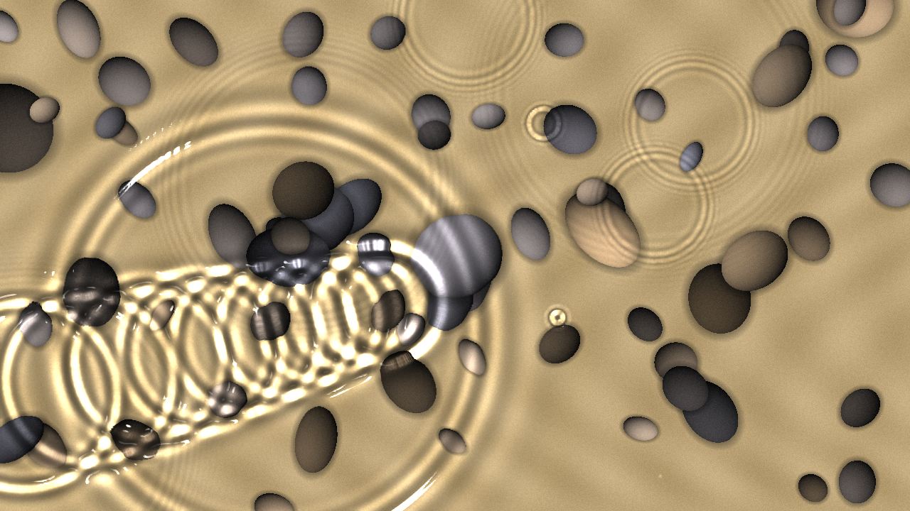
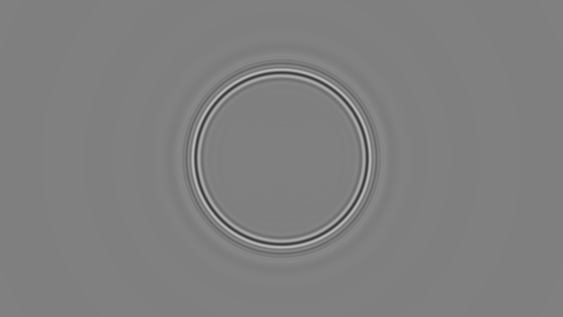
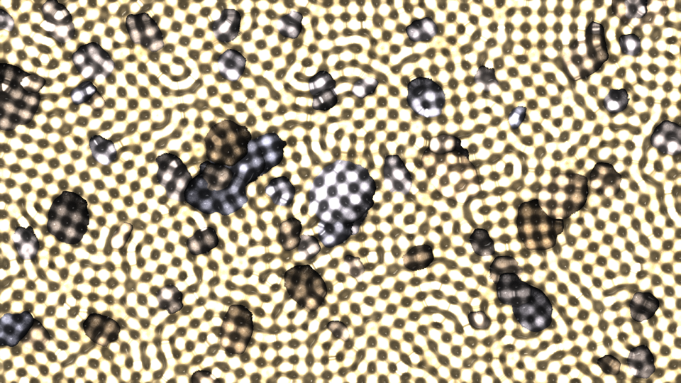

# Millpond user guide

> **Photosensitivity warning.** Faraday waves, new in v0.2.0, can flash. With **Shake** up, the
> pond stands up in a lattice that turns inside out as it oscillates, and the light it focuses
> onto the bed brightens and darkens the picture with it. At the default **Slow Motion** (8×)
> that happens about 1.25 times a second at the default 10 Hz **Drive**. At **Slow Motion 1× or
> 2×** it is fast. Measured over Resolume's demo clips under Resolume's demo bass at full Shake,
> the picture flashed up to **10 times a second** (20 at a 20 Hz Drive). That is far over the
> three-a-second line in broadcast guidance (Ofcom) and web guidance (WCAG 2.x). The lattice is
> also a strong regular pattern across the whole picture, which ITU-R BT.1702 and Ofcom treat as
> a hazard of its own. Flashing light and strong patterns can trigger seizures in people with
> photosensitive epilepsy. Shake is off by default. See [Flashing, and keeping it
> safe](#flashing-and-keeping-it-safe) before you turn it up in front of an audience.

Millpond is **ripples on water, for [Resolume](https://resolume.com) Arena and Avenue**, as an
FFGL effect, **SW Millpond**. Your clip becomes the bed of a pond, and you look straight down at
it through the water. Drop a pebble, skim a stone or let it rain. New in v0.2.0, the bass can
shake the whole pond up and down until it stands up in a lattice of **Faraday waves**.

Nothing in it is drawn on. The water obeys the linear water-wave equations exactly, with
gravity, surface tension, depth and viscosity, and the light obeys Snell's law and Fresnel's.
The rings, the still disc inside them, the net of sunlight on the bed and the wobble of the
picture all come out of those equations.



*A skim across the lower left, the rings of a pebble dropped a second and a half earlier, and a
light rain, on the harness's own card. Rendered by the plugin's offline harness, not captured
from Resolume.*

> **Before you rely on this:** it's at **v0.2.0**, and still early days. What's established is
> established offline, on an Apple Silicon Mac, by a harness that drives the plugin's own code
> in a headless GL context. The rings match the exact Cauchy–Poisson integral to 0.01%, the
> light matches Snell and Fresnel, and the Faraday lattice starts where the damped Mathieu
> equation says it must (to 7 × 10⁻⁵), answers at exactly half the drive, and has the spacing
> millpond's own dispersion relation gives. Thirty-one models that are wrong on purpose are all
> caught. **In Resolume** it has run in Arena 7.27.1 on Windows on software rendering, and, from
> v0.2.0, in **Arena 7.29.0 on a Mac**, where every control showed and the Faraday lattice
> **pulsed to a music file playing in the composition**. It has **never been in a show**, and the
> Faraday model is a model: real water departs from it (see [Known limits](#known-limits)). Try
> it on a spare layer before you put it in a show.
>
> This codebase was created with AI assistance, directed and reviewed by a human author.

---

## Installing

Drop the plugin into Resolume's effects folder and restart Resolume:

```
macOS    ~/Documents/Resolume Arena/Extra Effects/Millpond.bundle
Windows  %USERPROFILE%\Documents\Resolume Arena\Extra Effects\Millpond.dll
```

Avenue uses the same layout under its own folder name. SW Millpond appears in the effects
browser.

The macOS download is a universal build (Apple silicon and Intel), as a `.dmg` or a `.zip`. It's
**Developer ID-signed and notarised**, so the bundle just loads. The Windows download is an x64
installer or a `.zip`. The installer offers Arena's folder, or Avenue's on a machine that only
has Avenue. It isn't code-signed, so it trips SmartScreen once: **More info** → **Run anyway**.
Or skip the installer and copy `Millpond.dll` out of the `.zip` by hand.

**Upgrading from v0.1.0:** replace the old file with the new one. Compositions saved with v0.1.0
load unchanged: every v0.1.0 control keeps its place (only the About group's buttons moved
down one, to make room for User guide, and buttons hold nothing), and with Shake at 0 (the
default) the picture is v0.1.0's, bit for bit.

---

## Start here

1. Put **SW Millpond** on a clip. The clip is now the bed of a 1.5 m garden pond, 30 cm deep,
   under a light rain and a high sun. The bed wobbles and a net of sunlight plays over it.
2. Press **Drop**. A pebble lands in the middle: a ring runs out from it, long waves in front,
   short ripples behind, and still water inside.
3. Press **Skim**. A stone comes in from the left bank and hops across the pond, each hop
   shorter than the last, and sinks.
4. Turn **Rain** up or down. Turn **Depth** down to a few millimetres and the same rain throws
   slower, tighter rings, and the picture hardly wobbles.
5. For Faraday waves, play some music with a bass line in the composition, then turn **Shake**
   up. A quarter of its travel is the threshold. At three-quarters or more the pond stands up in
   a lattice of squares that rises and falls with the bass. Read [Faraday waves](#faraday-waves)
   first, and the warning above.

The defaults: Pond Size 1.5 m, Depth 0.3 m, clean water, Speed 1×, Banks Open, Detail 1024;
Pebble in the middle, 3.5 cm, Splash half its radius; Skim left to right at 2.1 m/s, 13°, 10
touches; Rain about 1.6 drops a second, 4 mm; Audio Pebbles and Audio Rain off; Caustics 1, Sun
85° up at 126°, 0.6° across, Reflection 1, Glint 135; View Picture, Mix 100%; Shake 0 (Faraday
off), Drive 10 Hz, Damping 2/s, Slow Motion 8×, Pattern Squares, Bass Bins 2.

---

## How it works, in one paragraph

A pebble is a crater pushed into the surface. From then on, every wavelength in the water
travels at the speed the dispersion relation gives it, ω² = (gk + σk³/ρ) tanh kh, and dies away
at the rate viscosity gives it. Each frame the surface goes through a Fourier transform on the
GPU, and each wave is advanced by exactly the right phase for the time that has passed, so
there is no time step to go unstable. Surface tension gives water a slowest speed at which a
ripple can carry energy (17.8 cm/s), which is why a stone leaves a ring with calm water in the
middle. The view ray bends at the surface (n = 1.333) and lands on your clip a depth below, and
sunlight refracted by the same surface bunches into the bright net on the bed. The same Depth
drives both halves: a shallow pond bends the picture less and slows its long waves.



*View → Height, three seconds after a 1.5 cm pebble on 2 m of clean water. The disc inside the
ring is still. Rendered by the offline harness.*

---

## The controls

Resolume's inspector shows most controls as a slider from 0 to 1, not in metres or hertz. This
guide gives each one's range and default.

### Pond

- **Pond Size**: the frame's height in metres, 0.1 to 20 (default 1.5 m). A small pond shows the
  ripples big; a lake shows many rings at once.
- **Depth**: 2 mm to 2 m (default 0.3 m). Shallow water holds its long waves back, and bends the
  picture less.
- **Surface Tension**: 0 is pure gravity waves, the middle of the travel (the default) is clean
  water, the top is twice that. Turn it down and the short capillary ripples go.
- **Viscosity**: from thinner than water up to golden syrup (default water). Syrup really is
  overdamped at short wavelengths, and the ripples die before they leave the stone.
- **Speed**: 0 freezes the water (and the rain), 1× is real time (default), up to 4×.
- **Banks**: *Open* (default) is a lake: what leaves the frame never comes back. *Walls* is a
  pool: the edges reflect exactly, to every order.
- **Detail**: the grid, 256, 512, 1024 (default) or 2048 along the long side. More is finer and
  costs more; see [Performance](#performance).
- **Still**: a button that flattens the water.

### Pebble

- **Drop**: a button. Drops a pebble at Pebble X/Y.
- **Pebble X**, **Pebble Y**: where it lands (default the middle).
- **Pebble Size**: 2 mm to 10 cm (default 3.5 cm). A small pebble makes capillary ripples; a big
  one throws gravity rings.
- **Splash**: how deep the crater is, up to 0.6 of the radius (default about half).
- **Scatter**: a random offset around the pebble point, up to half the frame (default 0).

### Skim

- **Skim**: a button. Throws a stone that comes in from the bank on the far side of Pebble X/Y
  and passes through that point.
- **Heading**: 0 to 360° (default 0, left to right).
- **Throw Speed**: 0.5 to 20 m/s (default 2.1 m/s, which fits the whole skim in a 1.5 m frame).
  A throw harder than the pond stops at the far bank.
- **Skim Angle**: the stone's flight angle at each bounce, 3 to 40° (default 13°).
- **Bounces**: how many times it touches before it sinks, 1 to 40 (default 10). Each bounce costs
  the same energy, so the hops shorten steadily.

### Rain

- **Rain**: drops a second over the whole frame, from none to 80 (default about 1.6). The drops
  fall in water-time, so a frozen pond has no rain on it.
- **Rain Size**: 1 mm to 2 cm (default 4 mm).

### Audio

- **Audio**: Resolume adds this one itself. It picks which sound reaches the plugin: **Local**,
  **Composition** (the default) or **External**. See [Where the sound comes
  from](#where-the-sound-comes-from).
- **Audio Pebbles**: 0 is off (default). Turned up, each hit in the music drops a pebble, its
  splash following how hard the hit was; higher is more sensitive.
- **Audio Rain**: 0 is off (default). Turned up, the rain thickens with the level.

### Light

- **Caustics**: the net of sunlight on the bed, 0 to 2 (default 1, the physical strength).
- **Sun Elevation**: 10 to 90° (default 85°). A camera looking straight down only sees glints
  under a high sun.
- **Sun Azimuth**: 0 to 360° (default 126°).
- **Sun Size**: the sun's angular radius, 0.1 to 10° (default 0.6°). The real sun is 0.27°;
  several degrees is haze. Bigger blurs the caustic net and widens the glints.
- **Reflection**: 0 to 3 times the exact Fresnel reflection of the sky (default 1). Looking
  straight down, water reflects 2%.
- **Sky**: the colour the water reflects (default a pale blue).
- **Glint**: how bright the sun is in its reflection (default 135 times the sky). 0 is none.

### Output

- **View**: *Picture* (default) is the effect. *Height*, *Slope* and *Caustics* show one model on
  its own, which also works as a source of pure water patterns.
- **Mix**: 0 is your clip untouched, 1 is the pond (default).

### Faraday

These six come after the About group. All of them do nothing while Shake is 0.

| Control | Range | Default | What it does |
| --- | --- | --- | --- |
| **Shake** | 0 to 4 × the threshold | 0 (off) | How hard the loudest bass shakes the tank. A quarter of the slider is the threshold, half is twice it |
| **Drive** | 5 to 120 Hz | 10 Hz | How fast the tank is shaken. The lattice answers at half of it, and is finer at higher drives |
| **Damping** | 0, then 0.1 to 30 per second | 2 per second | The tank walls' loss. Higher needs more bass to stand up, and lies down faster |
| **Slow Motion** | 1 to 100× | 8× | A stroboscope that shows the oscillation slower. 1× is off |
| **Pattern** | Stripes, Squares, Hexagons | Squares | Which lattice the shaken pond settles into |
| **Bass Bins** | 1 to 16 | 2 | How many of Resolume's lowest sound bands count as bass |

### About

The **About** group has the plugin's name, version, licence and maker, and buttons that open this
user guide, the project page, the source on GitHub and the support page in your browser. v0.2.0
added the **User guide** button.

---

## Faraday waves

Shake a tray of water up and down and, past a threshold, the surface stands up in a lattice of
standing waves that rise and fall at exactly half the shaking frequency. Michael Faraday saw it
in 1831. In Millpond the bass does the shaking.



*Full Shake on a steady drone, 8 s in, Rain off, every other control at its default (Squares,
10 Hz, Slow Motion 8×). Rendered by the offline harness.*

**What you'll see.** With Shake up and no bass, nothing much: the pond stays flat. When the bass
comes in loud enough to pass the threshold, a lattice grows out of the still water. At full Shake
it fills the frame in about two seconds. It rises and falls with the bass, and when the bass
drops it lies down again, at the Damping's rate: at the default 2 per second it is under a third
of its height after half a second and almost gone after two. The lattice is seen through the
same optics as everything else, so your clip wobbles through a grid of little lenses, and the
sun's net on the bed gathers into the same grid.

**Nothing about the lattice is drawn.** In the shaken tank's frame, gravity becomes g − a cos Ωt,
and every wave the pond already rings becomes a damped Mathieu oscillator. The waves at half the
drive frequency grow once the shake passes their threshold. Their spacing is the same dispersion
relation solved at half the drive: at the default 10 Hz it's 6.7 cm, about twenty-two cells up
the default 1.5 m frame. A nonlinear damping on the waves' envelope holds the lattice at a finite
height, and a kernel inside it decides whether stripes, squares or hexagons win.

**Shake.** It's in units of the threshold, because the threshold moves with Drive, Damping and
the water (from 0.21 g to 0.63 g across Drive at Damping 2). So the lattice starts at the same
place on the slider whatever you set: **a quarter of the way up is the threshold**, half is
twice it, the top is four times. Below a quarter, the bass never stands the pond up. The bass is
measured against its own loudest moment in the last 3 seconds, so a quiet track shakes it as
hard as a loud one, and only the loudest moments reach the full Shake. Over Resolume's demo
stems, Shake at half stood the pond up under a steady drone and about half of the bass stems,
and not under the beats; full Shake stood it up under all of them.

**Drive.** Higher drives make a finer lattice (2.4 cm cells at 20 Hz and 1.2 cm at 40 Hz,
against 6.7 cm at 10 Hz) and need more shake in g, which Shake already allows for. At the
default Pond Size and Detail the grid is about 5 mm a cell, so a 10 Hz lattice cell is 13 grid
cells across and a 40 Hz one only two, the finest the grid can hold. For high drives, raise
Detail or make the pond smaller.

**Damping.** The loss at the tank's walls, added to water's own viscosity for every wave. More
damping needs more bass to stand up and lies down faster. **It also acts on the ripples, the
rain and the pebbles** while Shake is above 0, even in silence: at the default 2 per second, a
raindrop's rings die within about a second. Turn Damping to 0 to keep the ripples as they are
with Shake off. The lattice then stands up on very little bass and takes much longer to lie
down.

**Slow Motion.** The lattice oscillates at half the Drive: 5 times a second at the default 10 Hz.
Each oscillation turns the lattice inside out twice, so unslowed it reverses ten times a second,
a high-contrast pattern flickering right in the photosensitive band. **Slow Motion is a
stroboscope, on at 8× by default.** The water keeps real time, so the lattice still stands up
and lies down with the music, but you see its oscillation 8 times slower. The price is that
anything that isn't the lattice, the rain and the pebbles, is seen in jumps, a few times a
second. Slow Motion works whenever Shake is above 0, bass or not. 1× turns it off; see
[Flashing](#flashing-and-keeping-it-safe) before you do.

**Pattern.** Stripes, Squares or Hexagons. In real tanks, which one appears depends on the
fluid, the drive frequency and the depth. Here it's your choice, and the physics then grows the
pattern you chose. Hexagons peak where three waves add, so they look the most violent at full
Shake.

**Bass Bins.** How many of the lowest bands of Resolume's sound analysis count as bass. Nobody
has measured which frequencies Resolume's bands hold, so this is the assumption, exposed rather
than hidden. Raise it if the lattice ignores your bass line.

---

## Where the sound comes from

Millpond reads **Resolume's own sound analysis** (the FFT Resolume hands to effects). It never
opens an audio device and never asks for the microphone. Audio Pebbles, Audio Rain and all of
Faraday's Shake listen to it.

Resolume adds an **Audio** control to the effect to choose what it hears:

- **Composition** (the default) is everything playing in the composition. Put a clip with sound
  anywhere in the composition, and Millpond hears it.
- **Local** is the sound of the clip the effect sits on. It works when Millpond is on a clip that
  has its own sound.
- **External** is Resolume's external audio input. On the Mac it was tried on, it heard
  nothing.

What was measured in Arena 7.29.0 on a Mac, with Shake up and Rain off:

- A **`.wav` file** (Resolume's demo `Bass 001.wav` or `Beat 001.wav`) playing on another layer,
  Audio on Composition: the lattice stood up and pulsed with the beat, and lay down when the
  clip was cleared.
- A **video file with a sound track**, with Millpond on that clip: the lattice pulsed on Local
  and on Composition.
- **Resolume's demo `.mov` clips in its AV folder have no sound track.** Their sound is in the
  matching `.wav` file beside them. With `Beat 001.mov` playing, Millpond heard silence. If the
  lattice doesn't move, check that the clip you're playing has sound at all.

---

## Flashing, and keeping it safe

**Faraday waves flash when Slow Motion is low.** Each time the lattice turns inside out, the
light it focuses onto the bed moves from one set of cells to the other, so the picture brightens
and darkens in a pattern across the frame. People with photosensitive epilepsy can have a
seizure from flashing light. The line in broadcast guidance (Ofcom) and web guidance (WCAG 2.x)
is **no more than three flashes in any second** over a large area of the picture. A flash here is
a rise and a fall in brightness of at least a tenth of white, so the line is six rises and falls
in a second.

Measured from the plugin's own output with xenon's rule (the whole picture, and every third of
the picture, in linear light), 640×360 at 60 fps, 20 s each. The beds are seven of Resolume's
demo clips under eight of Resolume's demo bass and beat stems (`Bass 001`–`006`, `Beat 001`,
`Beat 003`), plus a generated steady drone and a generated kick, ten pairings in all. Numbers
are rises and falls in the worst second, in the worst third of the picture; over 6 is over the
line.

| Setting | Pairings over the line | Worst |
| --- | --- | --- |
| Shake 0 (the default) | 0 of 10 | 5, the clip's own (`IntoTheGlow_02`) |
| Shake ½ (twice the threshold), Slow Motion 8× or 1× | 0 of 10 | 5, the clip's own |
| Full Shake, Slow Motion 8× | 1 of 10 | 7, on `IntoTheGlow_02`, which measures 5 bare |
| Full Shake, Slow Motion 8×, Drive 40 Hz | 0 of 10 | 5, the clip's own |
| Full Shake, **Slow Motion 2×** | 7 of 10 | 11 |
| Full Shake, **Slow Motion 1×** | 8 of 10 | 21 (the whole picture too) |
| Full Shake, Slow Motion 1×, Hexagons / Stripes | 8 / 7 of 10 | 21 / 21 |
| Full Shake, Slow Motion 1×, Drive 5 Hz | 9 of 10 | 23 |
| Full Shake, Slow Motion 1×, **Drive 20 Hz** | 6 of 10 | 41 (40 over the whole picture) |

What keeps it within the guidance, in everything measured:

- **Keep Slow Motion at 8× or above.** At 8× the lattice reverses 1.25 times a second at 10 Hz,
  and only one clip that already flickers went over.
- **Or keep Shake at half or below**, which never crossed the line at any Slow Motion here
  (though at half, the lattice didn't stand up under the beats at all).
- Because the bass is measured against its own recent peak, a quiet track flashes as much as a
  loud one. Turning the music down doesn't help; Shake and Slow Motion do.

**Regular patterns.** At full Shake, the lattice covers the whole picture with a regular grid of
light and dark cells, twenty or more up the frame, and it moves. Broadcast guidance (ITU-R
BT.1702, Ofcom) counts strong regular patterns, especially moving ones, as a risk of their own,
whatever the flash rate. To keep the lattice weaker, keep Shake lower, or lower Mix to bring
your clip back through it.

With Shake at 0, the default, none of this applies: the pond is v0.1.0's, and at Shake 0 no
pairing went over the line (the worst, 5, is the clip's own flicker).

None of this is a substitute for warning your audience. The [browser
demo](https://millpond-demo.stoatworks-labs.com/) opens with Shake at 0.

---

## Recipes

- **A garden pond:** the defaults. Press Drop now and then.
- **A puddle in the rain:** Depth to the bottom (a few millimetres), Rain up, Rain Size down.
  The long waves are held back, and the picture hardly wobbles.
- **A swimming pool:** Banks Walls, Depth up, Sun Size small. The rings come back off the edges.
- **Golden syrup:** Viscosity to the top and press Drop. The ripples die before they leave the
  stone.
- **Stones across a lake:** Pond Size up to 10 m or more, Throw Speed up, Bounces up, then Skim.
- **Ripples to the beat:** Audio Pebbles up from 0 until each hit drops a pebble; Scatter up to
  spread them.
- **Water patterns on their own:** View Height, Slope or Caustics, on any clip.
- **A bass line that stands the pond up:** Shake at three-quarters or full, a track with a
  steady bass, and the other Faraday controls at their defaults. For a larger lattice, lower
  Drive; for the ripples to stay between the bass notes, lower Damping.

---

## Performance

Measured by the offline harness on an Apple Silicon Mac (M4 Max), GPU time per frame at the
default Detail (the Shake 0 row with busy rain):

| | 720p | 1080p | 4K |
| --- | --- | --- | --- |
| Shake 0 | 0.9 ms | 1.0 ms | 2.4 ms |
| Shaken at 10 Hz, Slow Motion 1× | 1.5 ms | 1.7 ms | |
| Shaken at 10 Hz, Slow Motion 8× (mean) | 2.5 ms | 2.2 ms | |

Detail sets the grid, not the raster: the 1080p frame costs 0.85 ms at Detail 512 and 4.4 ms at
2048. With the stroboscope on, the frames where the water catches up a whole oscillation cost up
to 12 ms. Nothing has been timed inside Resolume, on Windows, or on another GPU.

---

## If it looks wrong

**Shake is up and nothing stands up.** No bass is reaching it, or not enough. Check the clip has
sound at all (Resolume's demo `.mov` clips don't; use the `.wav`), and that Audio is on
Composition, or on Local with Millpond on the clip that has the sound. Turn Shake past a quarter.
Raise Bass Bins if the bass line is higher than the lowest bands.

**With Shake up, the rain looks jerky and dies quickly.** That's Slow Motion and Damping acting on
everything, even in silence. Lower Damping, or turn Shake to 0 between songs.

**The lattice flickers fast.** Slow Motion is low. Put it back to 8× (see the warning).

**The lattice is faint or missing at a high Drive.** Its cells are small against the grid (see
[Faraday waves](#faraday-waves)): raise Detail or make the pond smaller.

**The picture doesn't wobble.** Depth is low, or the water is still: press Drop, or turn Rain up.
At Speed 0 the water is frozen.

**No glints.** The sun is too low: a camera looking straight down only sees the sun in a facet
tilted by half the sun's distance from overhead. Keep Sun Elevation high.

**The plugin does nothing, or Shake does nothing at all.** A shader didn't compile. If one of
the Faraday shaders fails, Millpond turns Shake off and runs as v0.1.0. The log has the error:

```
macOS    ~/Library/Logs/millpond/millpond.YYYY-MM-DD.log
Windows  %LOCALAPPDATA%\millpond\logs\millpond.YYYY-MM-DD.log
```

---

## Known limits

- **Run in Resolume only briefly:** in Arena 7.27.1 on Windows (software rendering, no sound
  device, so the Faraday controls that need bass weren't tried there) and in Arena 7.29.0 on a
  Mac. Never in a show, never timed inside Resolume, never on a GPU other than one Mac's.
- **Linear waves.** The craters are deeper than linear theory strictly covers, and the water
  responds linearly anyway: no breaking, no crown splash, no jet. A full Shake drives the lattice
  steeper than linear theory covers too, and it stays smooth where real water would throw
  droplets.
- **The Faraday model is a model.** A damped Mathieu oscillator with Lamb's damping is known to
  be quantitatively off against real viscous water, and Damping is one loss at one rate for
  every wave, which real walls aren't. The height the lattice saturates at comes from a constant
  that was chosen, not derived.
- **The default Pattern is a choice, and the literature doesn't back it at 10 Hz.** Squares is
  the default because it reads as a lattice. For water shaken at 10 Hz, theory predicts stripes,
  and experiments in silicone oil saw hexagons. Millpond doesn't work out the pattern from the
  fluid; Pattern sets it.
- **Slow Motion is on at 8× by default**, so the oscillation you see is slowed, and the rain and
  pebbles move in jumps whenever Shake is above 0.
- **With Shake above 0, silence still changes the pond.** Damping calms every ripple and Slow
  Motion judders the rain, even with no bass.
- **The bass is measured against its own peak over the last 3 seconds**, so a long quiet passage
  after a loud one shakes less until the peak decays, and a quiet track shakes as hard as a loud
  one. The defaults (10 Hz, Damping 2, Bass Bins 2) are where a first shake should start, not
  measurements of anything.
- **Resolume's sound bands are unmeasured.** Which frequencies Bass Bins covers isn't known.
- **A lattice finer than the grid is untested.** Above about 40 Hz on the default pond, the
  lattice is finer than the grid holds; what Millpond shows then hasn't been looked at.
- **The camera looks straight down**: no perspective, no horizon, and the sky it reflects is one
  colour.
- **Events land on frames.** A pebble lands in the frame its time falls in, up to one frame
  early.
- **It can flash** with Shake up and Slow Motion low (see above).
- **The inspector shows slider positions**, not metres or hertz. This guide gives the ranges.
- **No presets** and no OpenFX version.

---

## Links

- Project page: [stoatworks-labs.com/software/millpond](https://stoatworks-labs.com/software/millpond/)
- Source: [github.com/stoatworks-labs/millpond](https://github.com/stoatworks-labs/millpond)
- User guide: [stoatworks-labs.com/software/millpond/guide](https://stoatworks-labs.com/software/millpond/guide/)
- Browser demo: [millpond-demo.stoatworks-labs.com](https://millpond-demo.stoatworks-labs.com/)
- The video (v0.1.0, before Faraday): [youtube.com/watch?v=oAbXjVXFwYA](https://www.youtube.com/watch?v=oAbXjVXFwYA)

## Reporting something

If something's wrong, shout at
[github.com/stoatworks-labs/millpond/issues](https://github.com/stoatworks-labs/millpond/issues).
A screenshot, your Resolume version, the settings you changed from the defaults, what the clip
is (and whether it has sound), and the log are usually enough.
